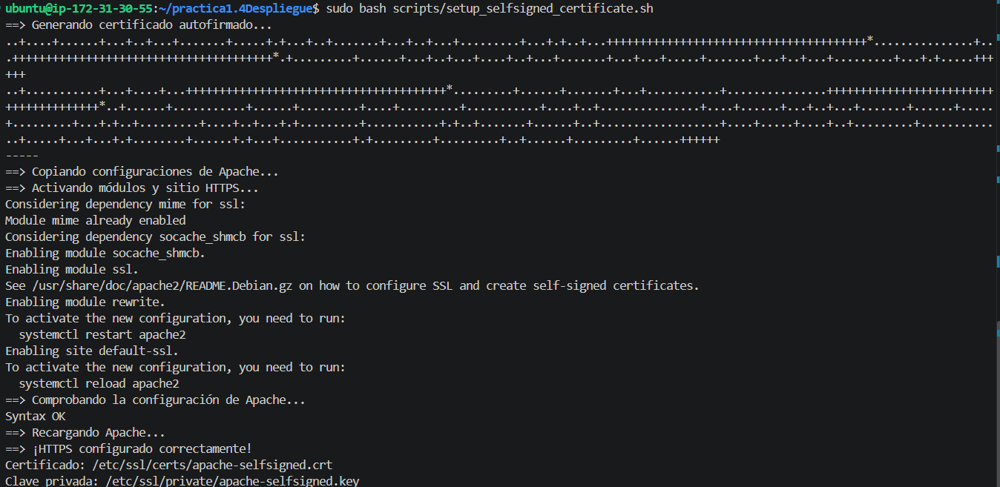
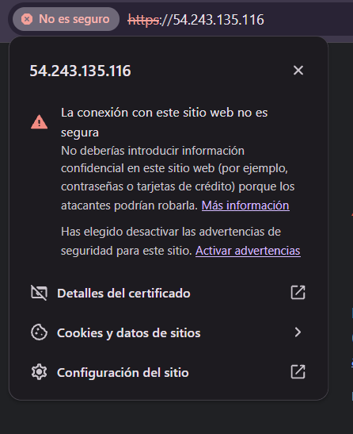
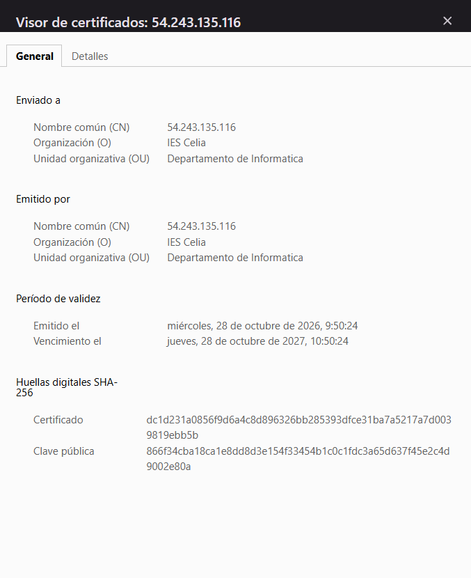

# Práctica 1.4 — Configuración de HTTPS con certificado autofirmado

## 1. Objetivo

El objetivo de esta práctica es configurar una aplicación web para que funcione mediante HTTPS, utilizando Apache y un certificado SSL/TLS autofirmado.

Para ello, he partido de la configuración de una instancia Ubuntu con LAMP y he preparado scripts Bash para automatizar la generación del certificado y la configuración del servidor web.

## 2. Requisitos previos

Para realizar esta práctica se han utilizado los siguientes recursos:

- Una instancia EC2 con Ubuntu en AWS.
- Acceso a la instancia mediante SSH desde Visual Studio Code.
- Apache, PHP y MySQL instalados.
- OpenSSL para generar el certificado.
- Un grupo de seguridad de AWS con los puertos necesarios habilitados:
  - **22/TCP:** acceso SSH.
  - **80/TCP:** acceso HTTP.
  - **443/TCP:** acceso HTTPS.

## 3. Estructura del proyecto

El repositorio contiene los archivos de configuración de Apache y los scripts necesarios para automatizar el proceso.

```text
practica1.4Despliegue/
├── README.md
├── conf/
│   ├── 000-default.conf
│   └── default-ssl.conf
└── scripts/
    ├── .env
    ├── .env.example
    ├── install-lamp.sh
    └── setup_selfsigned_certificate.sh
```

## 4. Generación del certificado autofirmado

Para generar el certificado se ha utilizado OpenSSL mediante el script `scripts/setup_selfsigned_certificate.sh`.

El script obtiene los datos necesarios del archivo `scripts/.env`, donde se configuran los campos del certificado, como el país, la provincia, la organización, el nombre común y el correo electrónico.

Se genera un certificado con una validez de 365 días y una clave RSA de 2048 bits. Los archivos generados se guardan en las siguientes ubicaciones:

- Certificado: `/etc/ssl/certs/apache-selfsigned.crt`
- Clave privada: `/etc/ssl/private/apache-selfsigned.key`

También se incluye una extensión Subject Alternative Name (SAN) para identificar la dirección configurada en el certificado.

Para ejecutar el script se utiliza el siguiente comando desde el directorio del proyecto:

```bash
sudo bash scripts/setup_selfsigned_certificate.sh
```

El script copia las configuraciones de Apache, habilita los módulos SSL y rewrite, activa el sitio HTTPS y comprueba la configuración antes de recargar el servicio.

### Evidencia 1. Ejecución del script



## 5. Configuración de Apache

Se han preparado dos archivos de configuración dentro del directorio `conf/`.

### `000-default.conf`

Este archivo configura el sitio HTTP, servido a través del puerto 80. Se ha añadido una regla de reescritura para redirigir las peticiones HTTP a HTTPS.

### `default-ssl.conf`

Este archivo configura el sitio HTTPS mediante el puerto 443. Incluye las directivas necesarias para activar SSL y especificar la ubicación del certificado y de su clave privada.

Las directivas principales utilizadas son:

```apache
SSLEngine on
SSLCertificateFile /etc/ssl/certs/apache-selfsigned.crt
SSLCertificateKeyFile /etc/ssl/private/apache-selfsigned.key
```

De esta forma, Apache puede atender las peticiones HTTPS utilizando el certificado generado.

## 6. Comprobación del acceso mediante HTTPS

Una vez ejecutado el script y recargado Apache, se ha comprobado el acceso a la aplicación mediante la dirección HTTPS de la instancia EC2.

Al tratarse de un certificado autofirmado, el navegador muestra una advertencia indicando que la conexión no es segura o que el certificado no es de confianza. Esto es normal, ya que el certificado no ha sido emitido por una autoridad certificadora reconocida.

### Evidencia 2. Advertencia del navegador

La siguiente captura muestra el mensaje de seguridad que aparece al acceder al sitio mediante HTTPS.



### Evidencia 3. Detalles del certificado

En esta captura se muestran los detalles del certificado utilizado por el sitio, incluyendo su información de identificación y los datos de validez.



## 7. Comprobaciones realizadas

Para verificar la configuración del servidor se han utilizado los siguientes comandos:

```bash
sudo apache2ctl configtest
sudo systemctl status apache2 --no-pager
curl -k -I https://localhost
```

Con estas comprobaciones se verifica la sintaxis de la configuración de Apache, el estado del servicio y la respuesta del servidor HTTPS.

Además, se ha comprobado el acceso desde el navegador y la redirección desde HTTP a HTTPS.

## 8. Uso de la inteligencia artificial

Durante la realización de esta práctica he utilizado la inteligencia artificial como herramienta de apoyo para comprender el funcionamiento de los certificados autofirmados, revisar los archivos de configuración de Apache, preparar y corregir